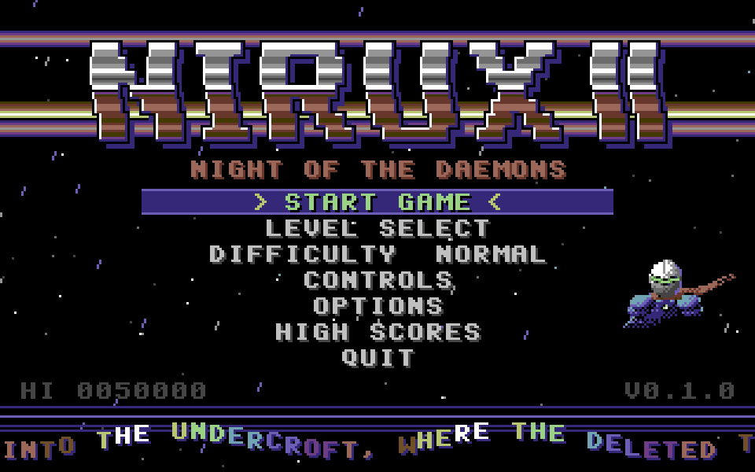

# NIRUX II - NIGHT OF THE DAEMONS

The second NIRUX game: an original Commodore 64 style action platformer
for the NIRUX desktop. NIRUX, the silent guardian from the first game,
follows NULL down into the Undercroft, where the deleted things go.
Sixteen C64 colours, raster bars, rain and lightning, and a gothic
soundtrack played live by a SID-style synthesiser written for the games.

**Status: stages 1 and 2 (0.1.0), more to come** · Part of the [NIRUX](https://github.com/nirucon/nirux) suite · [MIT License](LICENSE)



More screenshots: [the prologue](docs/screenshots/story.png),
[a stage intro](docs/screenshots/intro.png),
[the Process Graveyard](docs/screenshots/stage1.png),
[the cron bells](docs/screenshots/bells.png),
[the Gravedigger](docs/screenshots/gravedigger.png),
[the Swap Marsh](docs/screenshots/stage2.png),
[the controls](docs/screenshots/controls.png),
[the ending so far](docs/screenshots/ending.png).

## The story

The Core is free and the eight sectors wake again. But NULL was not
destroyed: it fled down into the Undercroft, where the deleted things go.
There it raises what nothing else wanted. Terminated processes walk again,
orphaned ones hunt in swarms, and the old daemons that served the system
now serve NULL. Every night the cron bells ring and the Undercroft wakes.

ECHO, the voice of the Core, cannot follow far; its signal breaks up the
deeper you go. A stranger called the Reaper watches from the hills. NIRUX
goes down alone.

If you have beaten the first game on this computer, NIRUX II welcomes you
back and starts you with an extra life.

The canon for the hero, the world and the music is
[docs/LORE.md](docs/LORE.md), shared with the first game. The plan for the
whole game, seven stages and NULL's Keep, is in
[docs/DESIGN.md](docs/DESIGN.md).

## How it plays

Run, jump, climb and fight through stages of a few minutes each. Every
stage you reach stays open in **Level select**, so one stage now and then
is a game of its own.

- **Your scarf is your life.** Every hit burns a piece of NIRUX's scarf,
  and you see it on the hero: three pieces, then the next hit costs a life.
  Shrines (with the Core's diamond) mend a piece and become the place you
  come back to; red threads mend one too.
- **The jump is firm.** A fixed arc with a little control in the air, and a
  short tap makes a short hop. Down and jump drops through a ledge.
- **The visor lamp** lights a cone ahead: hidden ledges show (and stay
  shown) and ghosts are held still and take double damage. It drains while
  you hold it and fills again when you let go.
- **Weapons from the urns:** the **bolt** (straight, more and stronger with
  each pickup), the **hammer** (thrown in an arc, falls through enemies and
  over shields), the **disc** (bounces off walls) and the **whip** (short,
  strong, an arc in front). Hold up to aim upwards. A hit never takes your
  weapon.
- **The cron bells** toll three times, then wraiths sweep across the
  screen: high ones to duck, low ones to jump.
- **Falling** into a pit or the black water burns a piece of the scarf and
  puts you back on the last firm ground.

| Stage | Name | Boss |
| --- | --- | --- |
| 1 | The Process Graveyard | the Gravedigger, who digs under you |
| 2 | The Swap Marsh | the Bog Daemon, who rises where it chooses |

Enemies so far: zombie processes rising from their graves, orphans in
swarms, winged daemons, ghost files that drift through walls, knights with
shields, fork bombs that split, and the wraiths of the bells.

## Controls

| Action | Keyboard | Gamepad |
| --- | --- | --- |
| Move, climb | arrows or WASD | left stick or D-pad |
| Jump | Space, Z or K | A / cross |
| Fire (hold up to aim up) | Ctrl, X or J | square, B / circle, right trigger |
| Visor lamp | Shift, C or L | triangle / Y, left trigger |
| Pause | Esc or P | Start |
| Back | Esc | Select |
| Fullscreen, mute | F11, M | |

PS3, PS4 and PS5, Xbox, 8BitDo and ordinary USB pads work through the
kernel's input devices and can be plugged in at any time. The **Controls**
entry in the title and pause menus shows the same table.

## The soundtrack

| Song | Where |
| --- | --- |
| Daemons | the title theme, D minor, with the hero's call from NIRUX |
| Descent | the prologue, A minor |
| Graveyard | stage 1, A minor, driving, with a harpsichord run |
| Marsh | stage 2, E minor, slow and murky |
| The Bells Toll | the bosses, C minor |
| Deeper | after a stage |
| To Be Continued | the ending so far |
| Signal Lost | game over |

`nirux-ii --render-wav SONG FILE` writes any of them to a WAV file
(`--list-songs` lists the names).

## Install

On NIRUX:

```sh
nirux extras install nirux-ii
```

From this repository: `./install.sh` builds it with cargo (it offers to
install cargo when it is missing) and installs `nirux-ii`, a desktop entry
and an icon in `~/.local`. `./uninstall.sh` removes them again
(`--purge` also removes the settings and the saved progress).

It needs X11 and nothing else; sound goes through `pw-cat`, `pacat` or
`aplay`.

## Command line

```text
nirux-ii                  play (fullscreen unless the settings say otherwise)
nirux-ii --windowed       play in a window
nirux-ii --level N        start a game at stage N (1 to 2)
nirux-ii --demo           start in the attract mode
nirux-ii --selftest [FRAMES]
                          play every stage on every difficulty with the
                          autopilot, without a window or sound, and check
                          the menus and the music
nirux-ii --snap SCREEN FRAMES FILE.ppm
                          write a picture of a screen (title, storyN,
                          introN, levelN, ending, controls) without a window
nirux-ii --render-wav SONG FILE [SECONDS]
nirux-ii --list-songs
nirux-ii --version
```

## Files

- Settings: `~/.config/nirux-ii/config.toml` (fullscreen, CRT lines, music
  and effect volume, echo, difficulty, the sound command).
- Progress and high scores: `~/.local/share/nirux-ii/save.toml`.
- It reads `~/.local/share/nirux-thegame/save.toml` only to see whether
  the first game has been beaten.

## Development

```sh
cargo fmt --all -- --check
cargo clippy --release --all-targets -- -D warnings
cargo test --release
sh tests/xvfb.sh target/release/nirux-ii 99
```

The tests check that every stage can be walked (no wall higher and no gap
wider than a jump), that the autopilot clears every stage including its
boss on Easy and Normal, that every line fits the screen, and that the
songs render cleanly. `tests/xvfb.sh` runs the game in a private Xvfb with
a temporary home and the sound going to a file. The engine (window,
scaling, synthesiser, gamepads) is shared with the first game, and
`src/hero.rs` is the hero's canon. The code has two dependencies: `x11rb`
and `libc`.

## License

MIT. See [LICENSE](LICENSE).
